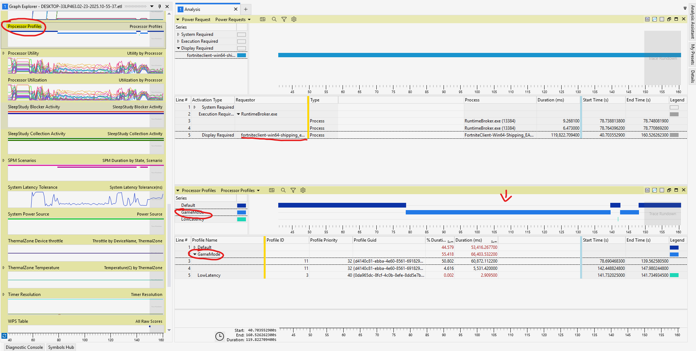

## Windows Power Settings
### Power Plans
#### Q: How do Windows power plan schemes, overlays, and profiles influence each other?
Microsoft's layered approach to power management isn't immediately intuitive, as certain settings only apply to specific plans and schemes. To explain how these layers work together, this section provides a diagram alongside a breakdown of their technical differences, command-line tools, and runtime behaviors.

<ins>Findings and Analysis</ins>

1. All built-in power plans inherit base settings from a power scheme personality. 
   * Applying a different power scheme personality to an existing plan overwrites the applicable values from its previously configured default scheme.
   * Microsoft recommends copying the Balanced power plan and adjusting its settings to match your performance needs, such as applying high-performance values typically found in the High Performance scheme.
   * https://learn.microsoft.com/en-us/windows/win32/power/power-policy-settings
   * https://learn.microsoft.com/en-us/windows-server/administration/performance-tuning/hardware/power/processor-power-management-tuning
2. Power plan settings maintain distinct **AC** (plugged in) and **DC** (battery) values.
   * AC values target desktop computers and plugged-in devices with a continuous power source.
   * DC values target mobile devices and laptops, allowing tradeoffs between performance and battery runtime. When unplugged, the system dynamically switches to its DC parameters to conserve energy.
3. Power Profiles allow the Balanced power plan to dynamically manage processor performance states (e.g., automatically engaging specialized profiles like Game Mode when known or identified games launch).
   * View all available power profiles using: `powercfg /listprofiles` or `powercfg /aliasesh` (h includes hidden aliases).
   * View specific profile settings using: `powercfg /queryprofile SCHEME_CURRENT PROFILE_LOWLATENCY` 
4. Power Scheme Overlays and Power Profiles only apply to power plans derived from `SCHEME_BALANCED`.
   * You can verify this behavior by comparing `powercfg /queryprofile SCHEME_MIN` (High Performance) against `powercfg /queryprofile SCHEME_BALANCED` (Balanced).
5. Power Scheme Overlays 
   * When using a Balanced power plan on Windows 11, you can adjust the overlay state via **Settings > System > Power > Power Mode**.
   * The three main options correspond to:
     * **Best Power Efficiency:** `OVERLAY_SCHEME_MIN`
     * **Balanced (Default):** `OVERLAY_SCHEME_NONE` (or `OVERLAY_SCHEME_HIGH`, Better Performance)
     * **Best Performance:** `OVERLAY_SCHEME_MAX`
   * To view active overlay settings, use: `powercfg /qh OVERLAY_SCHEME_MAX`
   * Only `OVERLAY_SCHEME_MIN` and `OVERLAY_SCHEME_MAX` have additional overlay values on my desktop computer.
   * https://learn.microsoft.com/en-us/windows-hardware/customize/desktop/customize-power-slider
6. Active Power Scheme Overlays can dynamically override and supply new Power Profile configurations.
   * Example `powercfg /queryprofile OVERLAY_SCHEME_MIN` and compare vs `powercfg /queryprofile OVERLAY_SCHEME_MAX`
7. Base power plan configurations and user overrides determine the default active state (`SCHEME_CURRENT`), but not necessarily the effective dynamic state.
   * You can also inspect user and group policy overrides using: `powercfg /queryaltitudes` or `powercfg /queryaltitudes <SCHEME_GUID>` for a specific scheme.
8. Process and Thread Quality of Service (QoS) levels introduce an additional layer of dynamic CPU scheduling and power optimization handled directly by the OS kernel scheduler.
   * https://learn.microsoft.com/en-us/windows/win32/procthread/quality-of-service
   * https://learn.microsoft.com/en-us/windows-hardware/customize/power-settings/configure-processor-power-management-options
   * https://learn.microsoft.com/en-us/windows-server/administration/performance-tuning/hardware/power/power-performance-tuning
9. Microsoft's naming conventions for base schemes versus overlay schemes use inverted terminology.
   * SCHEME_MIN = Minimum Power Savings (High Performance)
   * OVERLAY_SCHEME_MIN = Maximum Power Savings (Power Saver)

 

#### Q: What are the differences between the Windows Power Plans and their hidden settings?
The best way is to compare for yourself, there are several power plan management tools available for download online. I've also provided a basic powershell script that will switch between each power plan then export the data in a CSV format using Windows built-in power management tool powercfg.exe, see below for more information.

A complete list of default values extracted from built-in power plans on Windows 10 2019 LTSC:
* [PowerPlanSettingsCompare.csv](../FINDINGS/PowerPlanSettingsCompare.csv)

A script that enumerates all power plan settings and exports it to CSV:
* [PowerPlantoCSV.ps1](../../SCRIPTS/PowerPlantoCSV.ps1)

### Power Features
#### Q: How can you determine if your application is switching Windows Game Mode on or off using Windows Performance Analyzer?
1. Start a Windows Performance Recorder (WPR) capture choosing the profile option Resource Analysis > Power Usage before you run your test e.g. running a specific game or application.
2. Complete your test
3. Stop the recording
2. Open the capture in Windows Performance Analyzer (WPA), expand the Power Section and load the Processor Profiles data.
4. Analyze the graph for Game Mode status changes.
   

<ins>Findings and Analysis</ins>

See the following screenshot 

 
